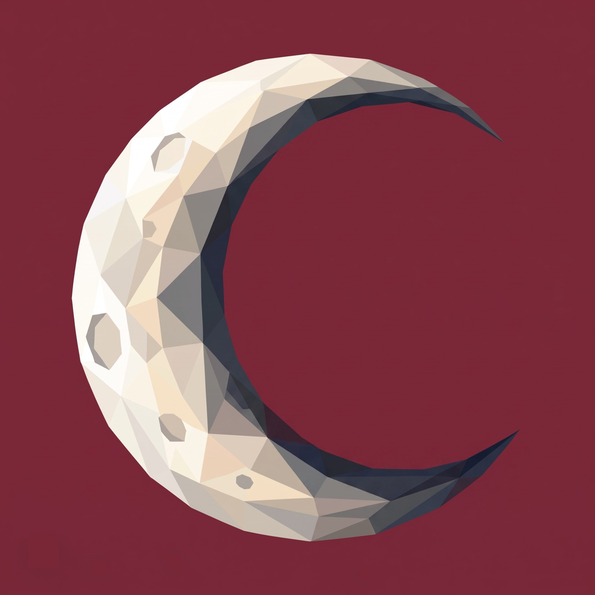
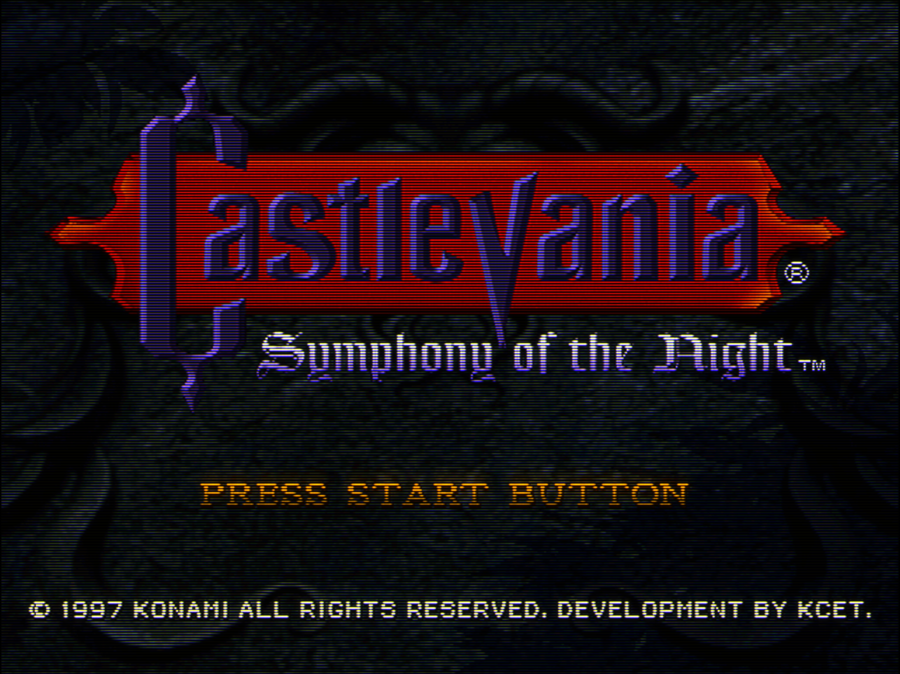
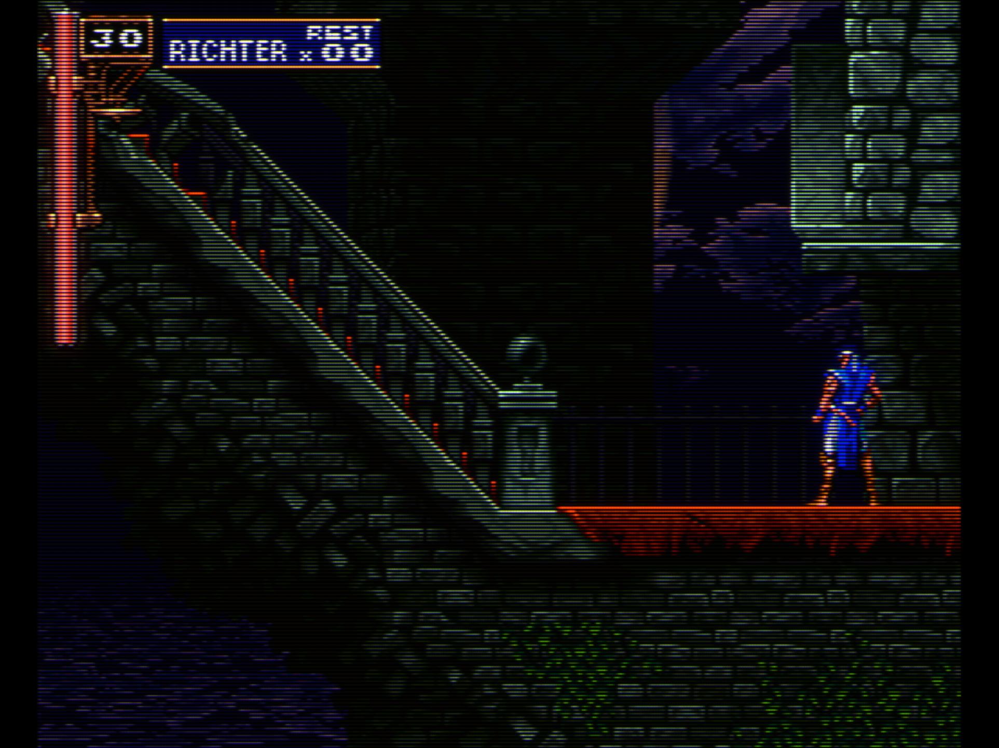
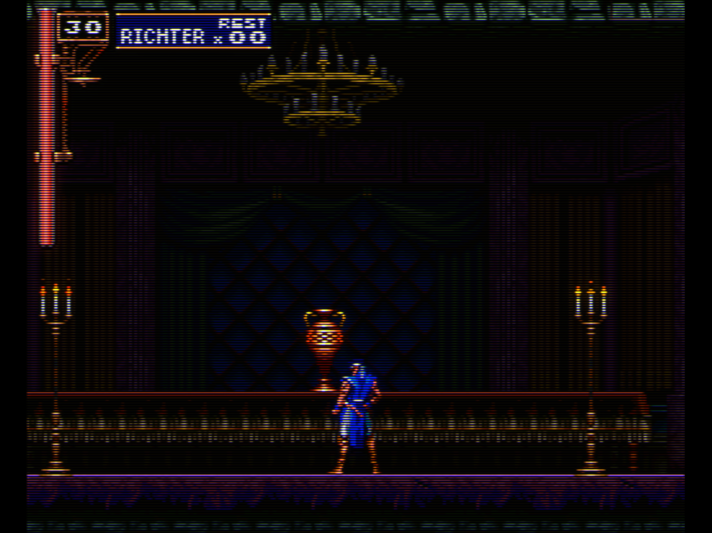
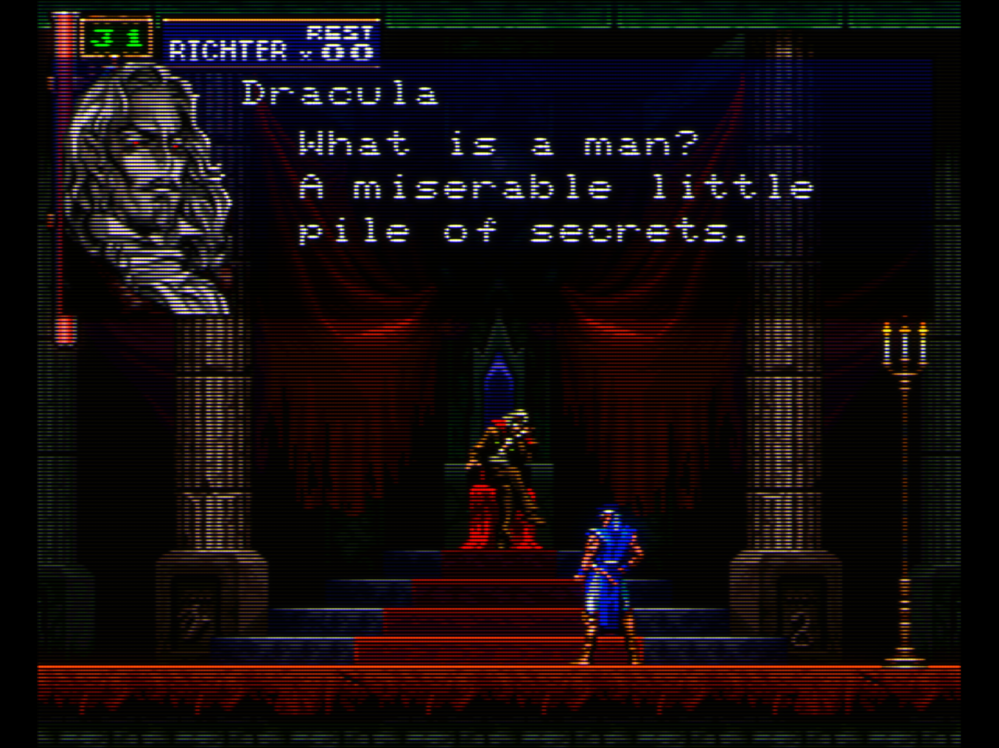
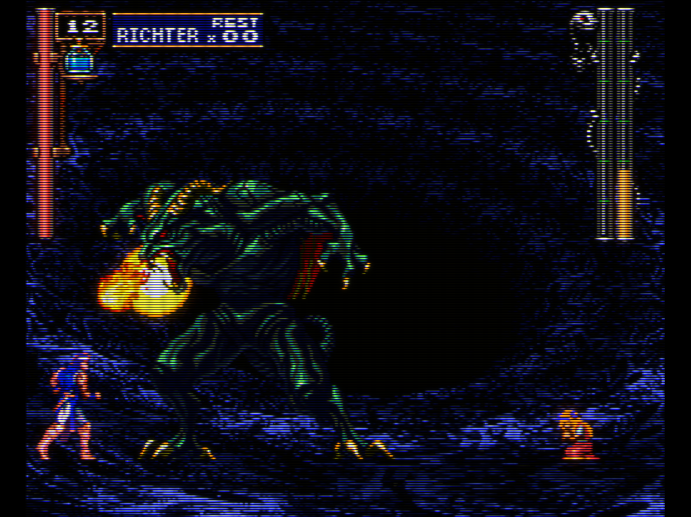
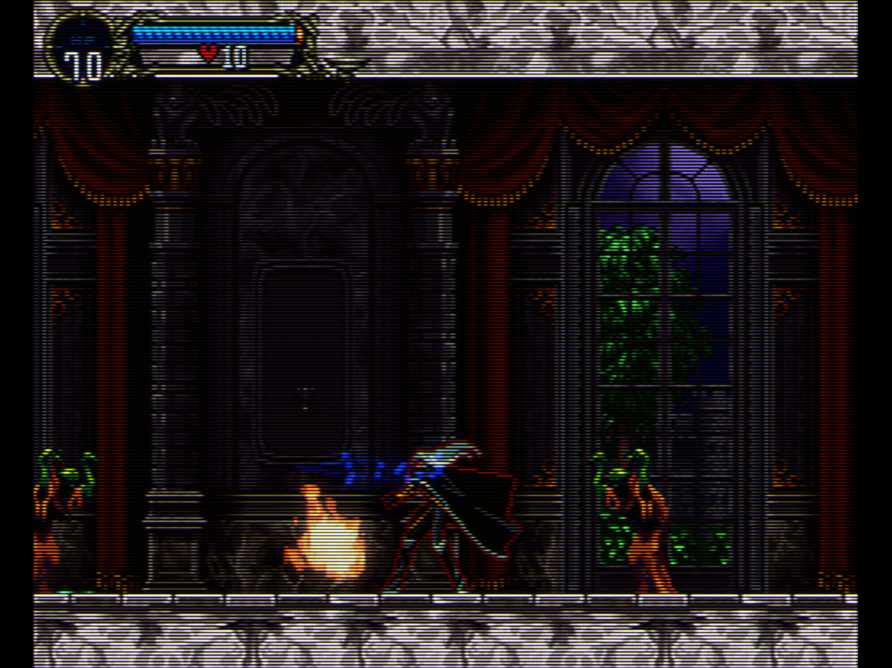
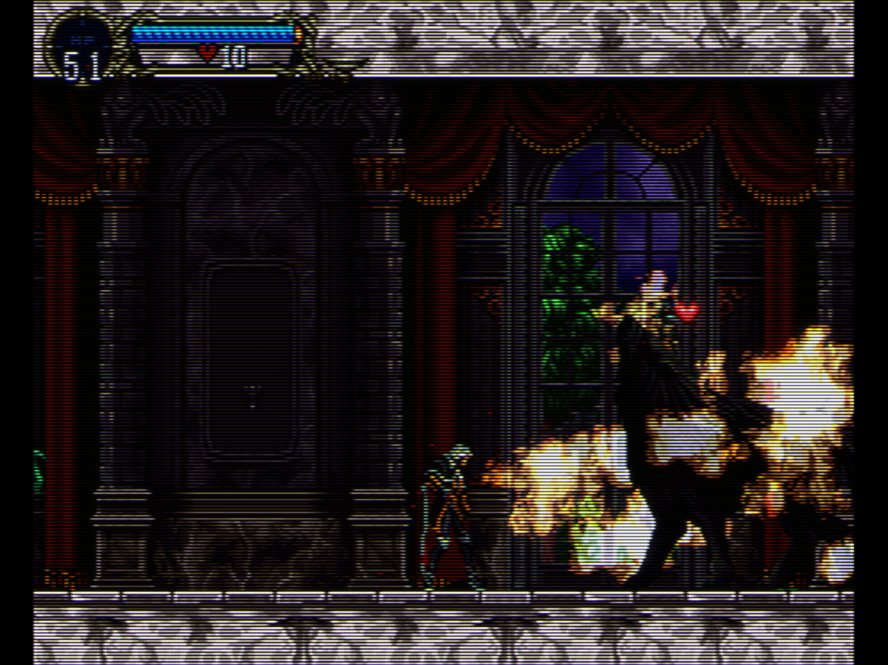
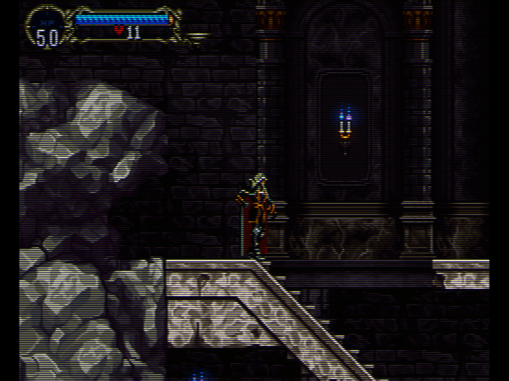

<p align="center"></p>

# MoonDoes CRT-Vision

A **SymphonyRecomp** mod that runs RetroArch `.slangp` CRT shader presets —
the MoonDoes configuration of the **Mega Bezel** shader chain — directly on the
game's **native PlayStation picture**, inside the game process.

There is no screen capture, no Vulkan layer, no Zink and no external
compositor: the recomp hands its native 256/320/512 × 240 picture to the mod,
the mod runs the full preset on it with [librashader](https://github.com/SnowflakePowered/librashader)'s
OpenGL runtime on the game's own thread and context, and draws the result 1:1
at whole pixels over the window.

> **Status:** Linux x86_64. Tested with SymphonyRecomp v0.5.1b
> (RecompOne runtime) on Mesa/radeonsi.

## Screenshots

Captured in-game on a 2560 × 1440 monitor with the MoonDoes_Lite_2 preset.
Click a picture to open it at full size: the scanlines and the phosphor mask
only show at 100 %.

<table>
<tr><td align="center"><a href="docs/screenshots/01-title-screen.png"></a><br><sub>Title screen (512 × 240)</sub></td><td align="center"><a href="docs/screenshots/06-intro-castlevania.png"></a><br><sub>Intro</sub></td><td align="center"><a href="docs/screenshots/02-prologue-staircase.png"></a><br><sub>Prologue — staircase</sub></td></tr>
<tr><td align="center"><a href="docs/screenshots/03-prologue-castle-hall.png"></a><br><sub>Prologue — castle hall</sub></td><td align="center"><a href="docs/screenshots/04-dracula-dialogue.png"></a><br><sub>Prologue — Dracula</sub></td><td align="center"><a href="docs/screenshots/05-prologue-beast-fight.png"></a><br><sub>Prologue — the beast</sub></td></tr>
<tr><td align="center"><a href="docs/screenshots/07-alucard-hall.png"></a><br><sub>Alucard — entrance hall</sub></td><td align="center"><a href="docs/screenshots/08-alucard-fire.png"></a><br><sub>Alucard — fire</sub></td><td align="center"><a href="docs/screenshots/09-alucard-staircase.png"></a><br><sub>Alucard — staircase</sub></td></tr>
</table>

## Features

- **Exact source resolution.** The preset always receives the picture the
  game really draws on each screen (256 columns in gameplay, 512 on the title
  and menus, 240 lines), so scanlines and the phosphor mask stay perfectly
  regular.
- **Integer vertical scale.** 6× at 1440p, 4× at 1080p; the mask is rendered at
  the drawn area's own size, never resampled.
- **Gameplay fills the screen.** In gameplay SOTN only draws 207 of its 240
  lines. While the game's own black bands stay empty (for half a second), the
  mod reads just those lines and fills the screen height; title and menus are
  shown whole in 4:3. Dropping the crop waits 0.75 s, so screen shakes or
  effects touching the bands do not make the picture jump.
- **Fullscreen only.** In windowed mode, or while the mouse is on the menu bar
  or a menu is open, the recomp's own interface is shown untouched.
- **Emissive light (optional).** Bright, coloured pixels (candles, torches,
  magic) light up their surroundings, on the native picture before the CRT
  pass, so the glow gets scanlines and mask like everything else.
- **Frame generation 60 → 120 (experimental, off by default).** See below.
- About **0.2–0.3 ms** of CPU per frame; the game keeps its 60 fps.

## Installation (players)

Download the release zip and follow [`docs/INSTALL.md`](docs/INSTALL.md).
In short: copy the `crtvision` folder into the game's `mods/` folder, start the
game, enable **MoonDoes CRT-Vision** in the **Mods** menu, set the recomp's
render scale to **1x** and play in fullscreen.

## Options

Mods → MoonDoes CRT-Vision → gear icon. Settings are saved in
`mods/crtvision/crtvision.json`.

| Option | Default | Notes |
|---|---|---|
| CRT enabled (fullscreen) | on | |
| Mask strength | 0.30 | Phosphor mask (`maskstr`); lower is softer |
| Frame generation 60 → 120 (experimental) | off | Linux only, needs VRR; see below |
| Emissive light (candles, torches, magic) | on | |
| Light intensity | 0.53 | 0 – 2 |
| Threshold (what glows) | 0.95 | Brightness from which a pixel emits light |
| Radius (reach) | 3.2 px | In native PSX pixels |
| Integer vertical scale | on | Whole multiples of the picture's lines |

`crtvision.json` also holds `preset` (absolute, or relative to the mod
folder), `params` (any preset parameter), and the crop settings
(`cropTop`, `cropBottom`, `cropLines`).

### Emissive light

A separable gaussian of the picture's bright pixels, added with a screen blend.
Coloured light (fire, magic) is favoured over white and grey (text, stone).
It is a 2D effect working on the final picture: it cannot tell a light from a
very bright, saturated sprite, so some characters may glow slightly. Raise the
threshold if that bothers you.

### Frame generation (experimental)

Presents 120 pictures per second from the game's 60 without changing the game
speed: a picture is generated between each pair of frames by motion
estimation on the native picture (8×8 blocks, ±8 px search, integer motion
only, so pixel art is never resampled), each one goes through the CRT preset,
and the real frame is presented half a frame (8.3 ms) after the generated one.

- **Linux only, experimental.** It may cause occasional flicker, and adds about
  8 ms of latency.
- **Requires Variable Refresh Rate** (VRR / FreeSync / G-Sync) enabled in both
  the system and the monitor — in GNOME: *Settings → Displays → Variable
  Refresh Rate*. On a fixed refresh rate that is not a multiple of 120 Hz the
  pictures would not arrive evenly.
- It is skipped after a game stall (room loads) instead of presenting two
  pictures back to back.

## Building

Requirements: a recent stable Rust toolchain (tested with 1.95), a C/C++ toolchain (librashader builds
SPIRV-Cross and glslang), Python 3.

```sh
./scripts/build.sh     # dist/crtvision, ready to copy into mods/
./scripts/package.sh   # dist/MoonDoes-CRT-Vision-v<version>-linux-x86_64.zip
```

The C# part (`mod/source/CrtVision.cs`) is compiled by the recomp itself when
the game starts; there is nothing to build for it.

## How it works

```
SymphonyRecomp frame
 ├─ OutputPanel.SetTexture(native picture)   ← hooked: crop decision, glow,
 │                                              librashader preset (+ generated frame)
 ├─ OutputPanel.Draw                          ← hooked: result drawn 1:1, whole pixels
 ├─ swap                                      (generated frame when frame generation is on)
 └─ FrameClock.Throttle                       ← hooked: real frame presented half a frame later
```

- `mod/source/CrtVision.cs` — the mod. RecompOne compiles C# mods at start-up;
  the hooks use MonoMod's `Hook`, which the recomp ships, through reflection.
- `native/crtvision-gl` — Rust `cdylib` exposing a small C API
  (`cvgl_create`, `cvgl_render`, `cvgl_analyze`, `cvgl_set_glow`,
  `cvgl_interpolate`, `cvgl_present`…) over librashader's OpenGL runtime, plus
  the crop analysis (asynchronous PBO readback), the emissive light and the
  frame generation passes. Every call saves and restores the OpenGL state it
  touches.
- `presets/MoonDoes_Lite_2` — the default preset and all its shaders.

The mod hooks internal methods of the RecompOne runtime. A recomp update that
renames them disables the mod (it reports the error in its panel; the game
keeps running normally) until it is updated.

### Windows

The C# side and the hooked methods are the same on Windows, and librashader
supports it, but the native library would need a Windows build
(`crtvision_gl.dll`, `wglGetProcAddress` instead of GLX/EGL) and the mod would
have to load the right file. Not done yet.

## Credits

This mod stands on the work of many people — see [`CREDITS.md`](CREDITS.md).
Above all, thanks to **HyperspaceMadness** (Mega Bezel) and **guest(r)**
(CRT-Guest-Advanced), whose shaders are the heart of the CRT look.

## License

- Mod and native library: **GPL-3.0-or-later** ([`LICENSE`](LICENSE)).
- librashader: MPL-2.0 or GPL-3.0-only ([`LICENSES/MPL-2.0.txt`](LICENSES/MPL-2.0.txt)).
- Shaders under `presets/`: each keeps the license and copyright notice in its
  own header (GPL-2.0-or-later or GPL-3.0-or-later for most, a few MIT or
  public domain).

Castlevania: Symphony of the Night is © Konami. SymphonyRecomp/RecompOne belong
to their authors. This repository contains no game code or assets.
