<p align="center"></p>

# MoonDoes CRT-Vision

A **SymphonyRecomp** mod that runs RetroArch `.slangp` CRT shader presets —
the MoonDoes configuration of the **Mega Bezel** shader chain — directly on the
game's **native PlayStation picture**, inside the game process.

There is no screen capture, no Vulkan layer, no Zink and no external
compositor: the recomp hands its native 256/320/512 × 240 picture to the mod,
the mod runs the full preset on it with [librashader](https://github.com/SnowflakePowered/librashader)'s
OpenGL runtime on the game's own thread and context, and draws the result 1:1
at whole pixels over the window.

> **Status:** Linux x86_64. Tested with SymphonyRecomp v0.5.1b
> (RecompOne runtime) on Mesa/radeonsi.

## Screenshots

Captured in-game on a 2560 × 1440 monitor with the MoonDoes_Lite_2 preset.
Click a picture to open it at full size: the scanlines and the phosphor mask
only show at 100 %.

### Before and after

Castle entrance — the game as it is, with the CRT preset, and with the CRT
preset and the dynamic light (candles and torches):

<table>
<tr><td align="center"><a href="docs/screenshots/entrance-1-no-mod.png">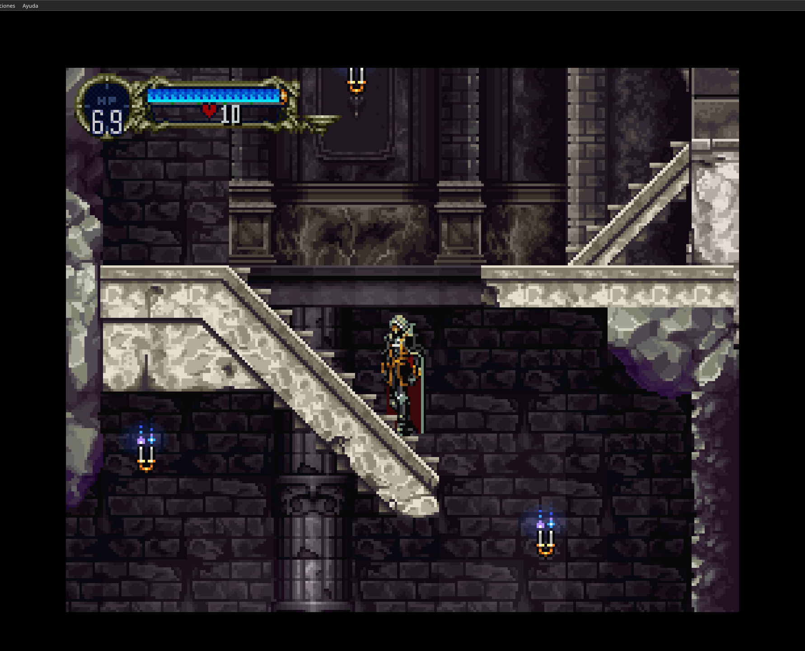</a><br><sub>Without the mod</sub></td><td align="center"><a href="docs/screenshots/entrance-2-crt.png">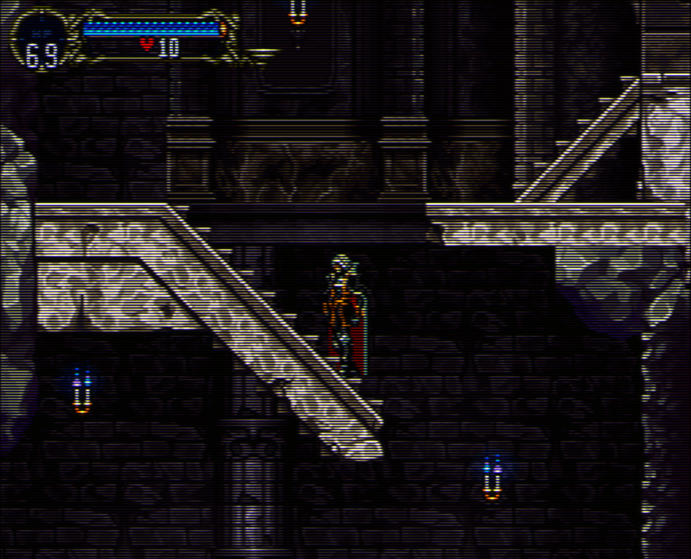</a><br><sub>CRT</sub></td><td align="center"><a href="docs/screenshots/entrance-3-crt-light.png">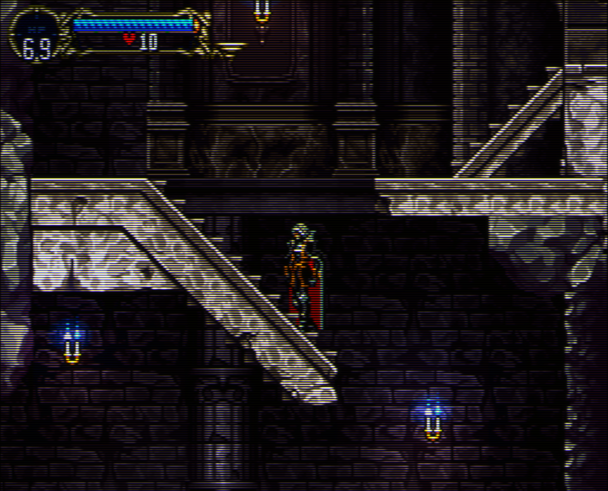</a><br><sub>CRT + dynamic light</sub></td></tr>
</table>

Prologue — the CRT preset alone, and with the dynamic light:

<table>
<tr><td align="center"><a href="docs/screenshots/prologue-1-crt.png">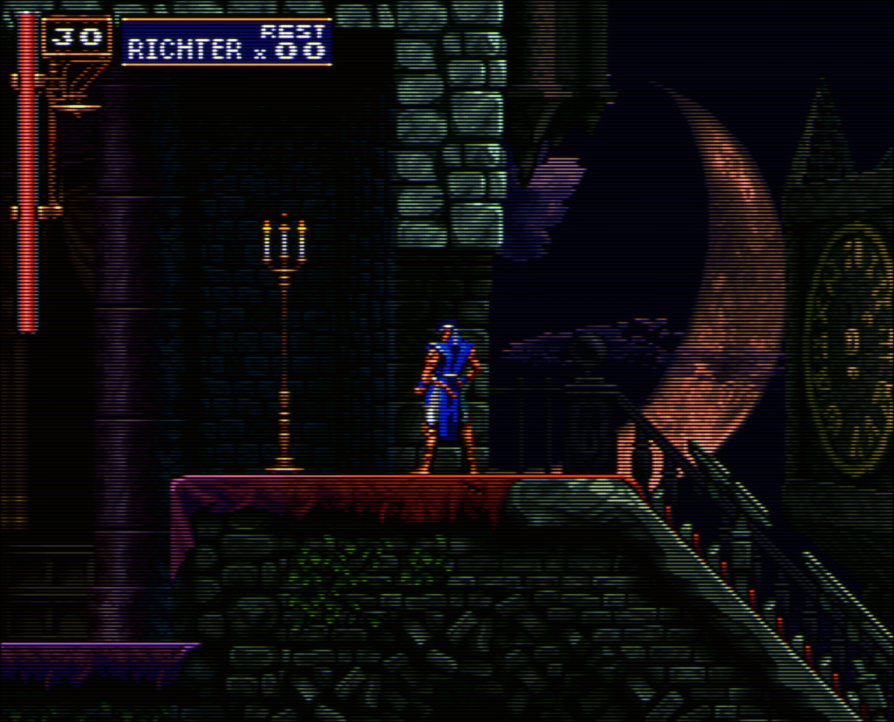</a><br><sub>CRT</sub></td><td align="center"><a href="docs/screenshots/prologue-2-crt-light.png">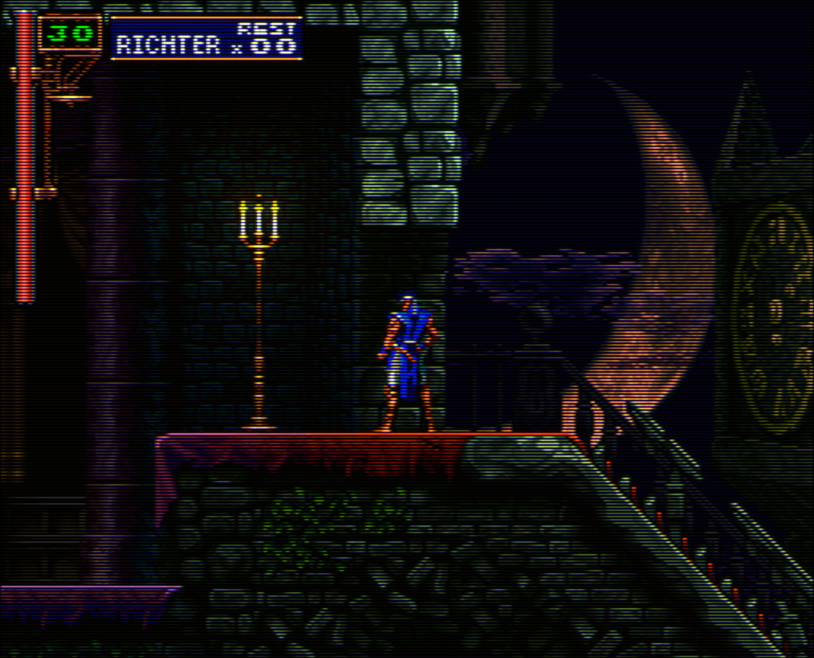</a><br><sub>CRT + dynamic light</sub></td></tr>
</table>

### Gallery

<table>
<tr><td align="center"><a href="docs/screenshots/title-screen.png">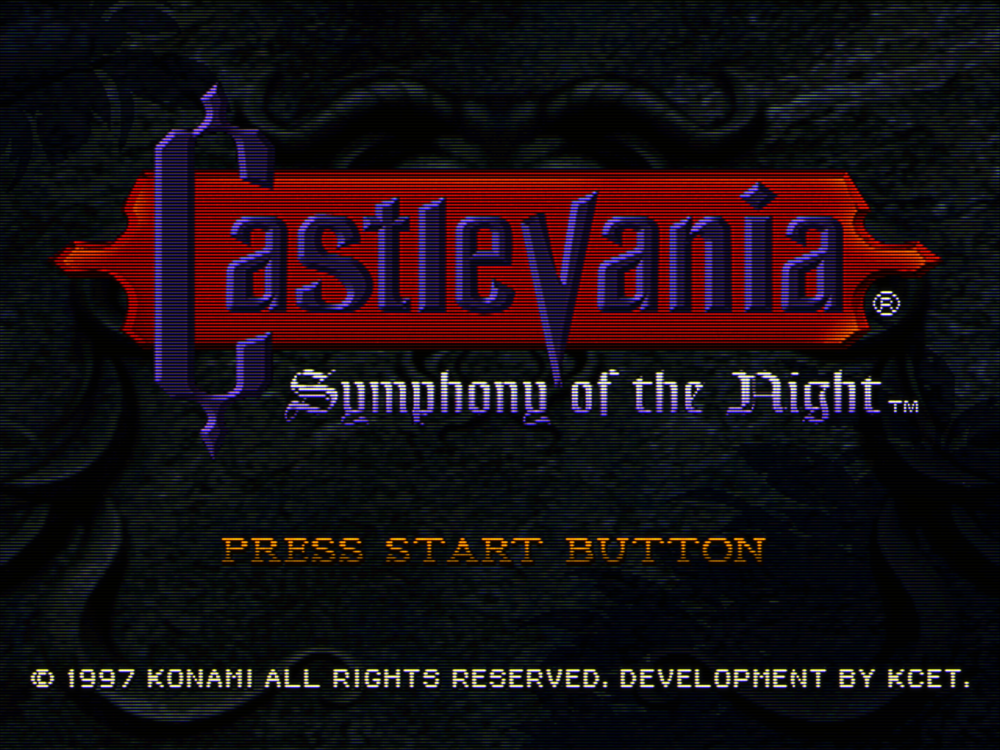</a><br><sub>Title screen (512 × 240)</sub></td><td align="center"><a href="docs/screenshots/intro.png">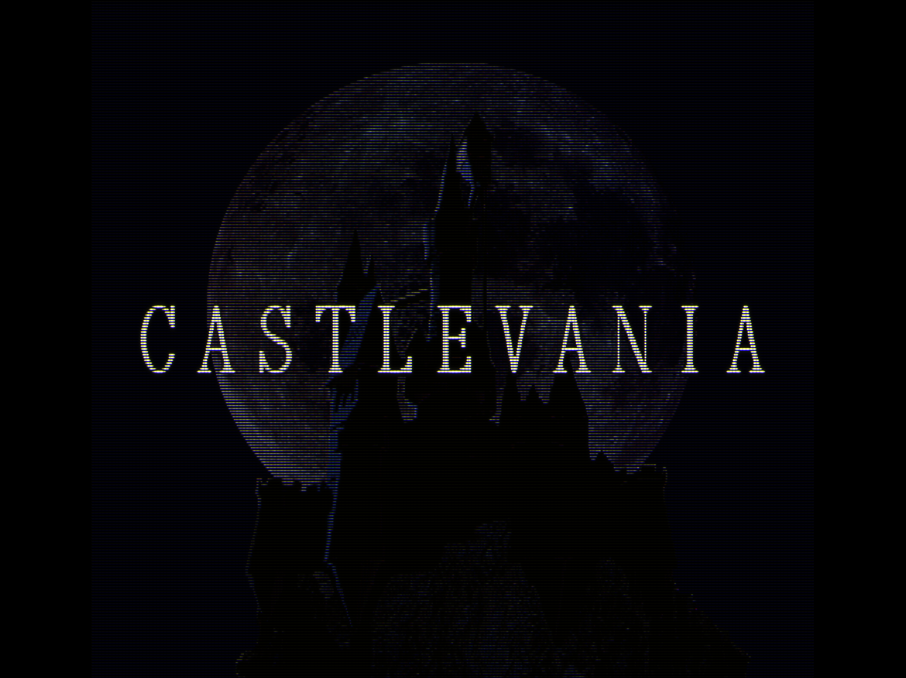</a><br><sub>Intro</sub></td><td align="center"><a href="docs/screenshots/richter-dialogue.png">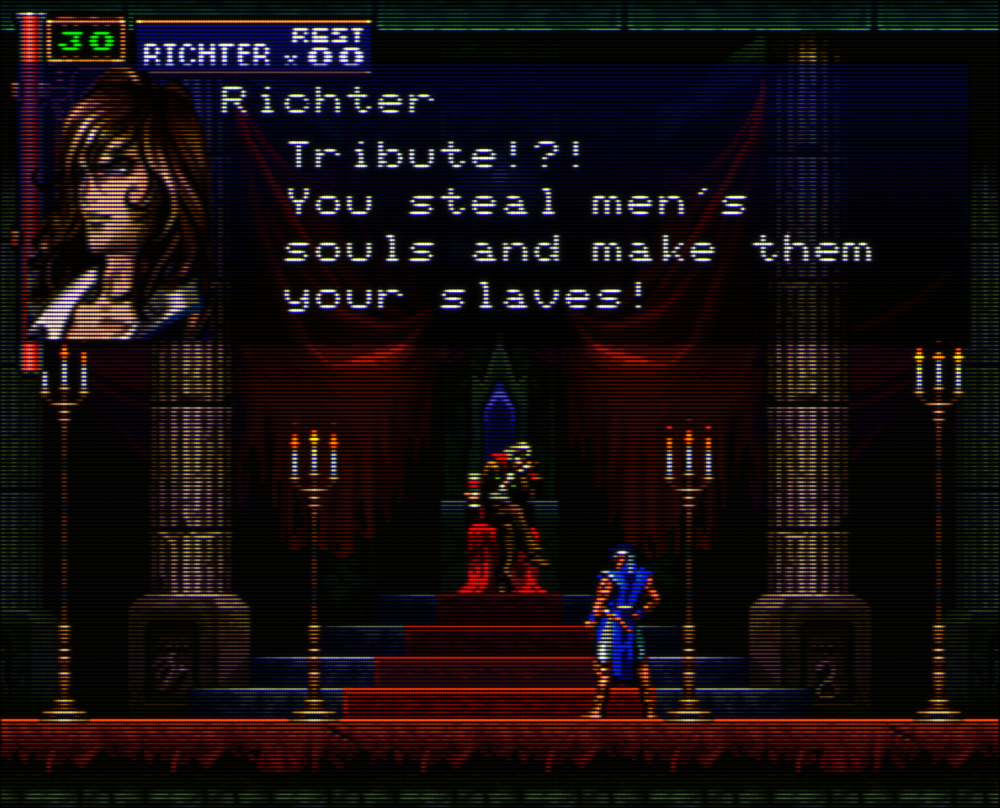</a><br><sub>Prologue — Richter</sub></td></tr>
<tr><td align="center"><a href="docs/screenshots/dracula-dialogue.png">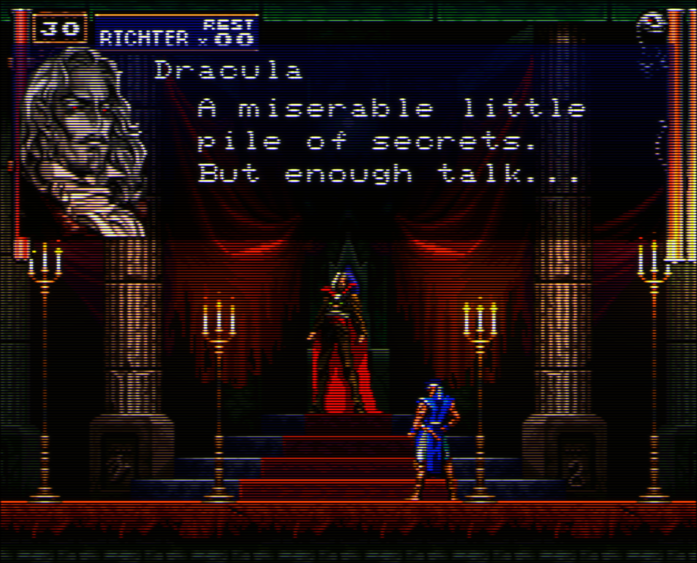</a><br><sub>Prologue — Dracula</sub></td><td align="center"><a href="docs/screenshots/dracula-fireballs.png">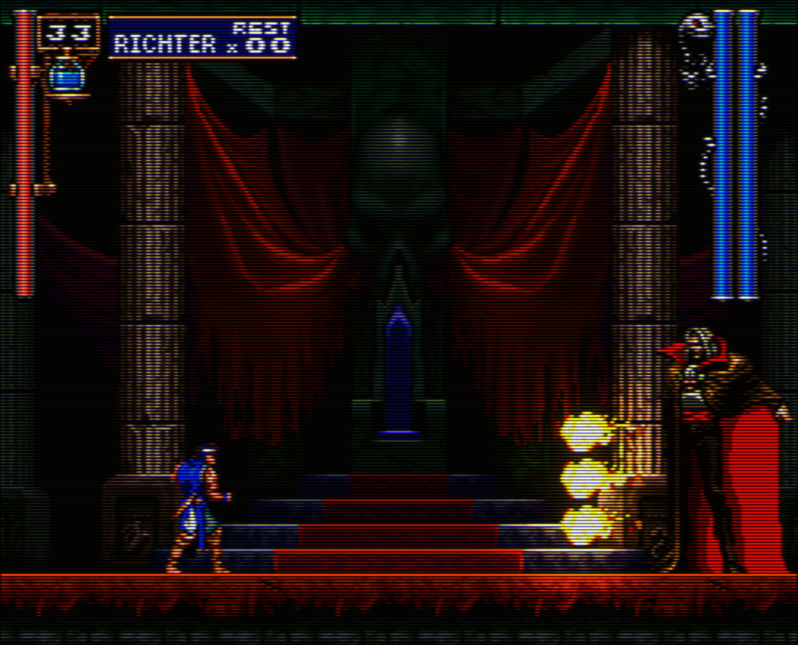</a><br><sub>Prologue — Dracula's fireballs</sub></td><td align="center"><a href="docs/screenshots/castle-entrance-lightning.png">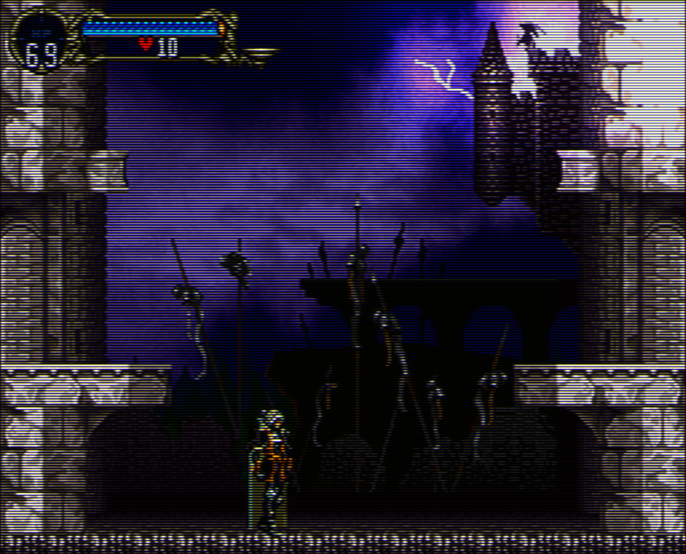</a><br><sub>Castle entrance — lightning</sub></td></tr>
</table>

## Features

- **Exact source resolution.** The preset always receives the picture the
  game really draws on each screen (256 columns in gameplay, 512 on the title
  and menus, 240 lines), so scanlines and the phosphor mask stay perfectly
  regular.
- **Integer vertical scale.** 6× at 1440p, 4× at 1080p; the mask is rendered at
  the drawn area's own size, never resampled.
- **Gameplay fills the screen.** In gameplay SOTN only draws 207 of its 240
  lines. While the game's own black bands stay empty (for half a second), the
  mod reads just those lines and fills the screen height; title and menus are
  shown whole in 4:3. Dropping the crop waits 0.75 s, so screen shakes or
  effects touching the bands do not make the picture jump.
- **Fullscreen only.** In windowed mode, or while the mouse is on the menu bar
  or a menu is open, the recomp's own interface is shown untouched.
- **Dynamic lighting, in three groups.** The game's own fire, read from SOTN's
  object table — the rooms' candles and torches (on by default), the fire
  enemies burst into when destroyed, and fire attacks (not magic), each turned
  on and tuned separately — glows and lights up the surfaces around it, on the native picture before the CRT pass, so the
  light gets scanlines and mask like everything else. Characters are lit when
  they stand near a light, but never glow by themselves.
- **Frame generation 60 → 120 (experimental, off by default).** See below.
- **Load any `.slangp` preset.** A built-in browser (Browse…) loads Mega Bezel
  and RetroArch slang presets exactly as they are configured; Default goes
  back to MoonDoes_Lite_2. See *Loading other presets* below.
- About **0.2–0.3 ms** of CPU per frame; the game keeps its 60 fps.

## Installation (players)

Download the release zip and follow [`docs/INSTALL.md`](docs/INSTALL.md).
In short: copy the `crtvision` folder into the game's `mods/` folder, start the
game, enable **MoonDoes CRT-Vision** in the **Mods** menu, set the recomp's
render scale to **1x** and play in fullscreen.

## Options

Mods → MoonDoes CRT-Vision → gear icon. Settings are saved in
`mods/crtvision/crtvision.json`.

| Option | Default | Notes |
|---|---|---|
| CRT enabled (fullscreen) | on | |
| Mask strength | 0.30 | Phosphor mask (`maskstr`); lower is softer |
| Frame generation 60 → 120 (experimental) | off | Linux only, needs VRR; see below |
| Candles and torches (any flame colour) | on | The rooms' lights while they burn |
| Death fire (destroyed enemies and broken candles) | off | The fire enemies and candles burst into when destroyed |
| Fire attacks (player and enemies, not magic) | off | Every fire attack |
| ↳ Intensity (each group) | 0.95 / 0.51 / 0.53 | All the group's light, halo and room (0 – 2; 0 is off) |
| ↳ Halo radius (each group) | 3.4 / 2.6 / 2.6 px | Glow around each source itself, in native PSX pixels |
| ↳ Room lighting (each group) | 1.62 / 0.80 / 0.85 | How much the sources light up the surfaces around them (0 – 2) |
| ↳ Light reach (each group) | 19 / 9 / 10 px | How far that light goes, in native PSX pixels |
| Restore all defaults | — | Every option and the default preset back to how the mod ships (the crop and fullscreen settings of the profile stay) |
| Integer vertical scale | on | Whole multiples of the picture's lines |
| Crop the game's black bands | on | In gameplay, fill the screen height once the bands stay empty; off always shows the whole picture |

`crtvision.json` also holds `preset` and `defaultPreset` (absolute, or
relative to the mod folder), `params` (overrides for the default preset),
`browseFolder`, the crop settings (`cropTop`, `cropBottom`, `cropLines`), the
light lists, and `debugLights` (the debug view, see
[docs/LIGHT-SOURCES.md](docs/LIGHT-SOURCES.md)).

While the mod is on, the screen does not blank or lock on Linux (GNOME): the
desktop only counts keyboard and mouse as activity, not a gamepad, so the mod
holds an idle inhibition while the game runs. Turning the mod off in the Mods
menu releases it.

### Loading other presets

**Browse…** opens a file browser inside the game, with shortcuts to the mod's
presets, RetroArch's shader folders (native, Flatpak, Snap) when present, and
the last folder used. Double-click a `.slangp` to load it; **Default** returns
to the bundled MoonDoes_Lite_2. The choice is saved in `crtvision.json`.

- Presets load **exactly as configured**: the mask strength slider and the
  `params` overrides only apply to the default preset.
- **Mega Bezel presets** that place the screen themselves (bezels,
  reflections; any Mega Bezel aspect mode other than *Full*) get the whole
  window, as in RetroArch. Every other preset is drawn in the CRT area, at
  integer scale with the gameplay crop, like RetroArch with the core's aspect
  ratio. Mega Bezel stretches the 256-column gameplay to 4:3, as a PlayStation
  did on a TV.
- Only **`.slang`** presets work (librashader); the old `.glsl` and `.cg`
  ones do not. The first compile of a large preset takes a few seconds (the
  game pauses); librashader caches it, so later loads are faster. A preset
  that fails to load leaves the current one running and shows the error.
- Tested with Mega Bezel `MBZ__3__STD`, `crt-guest-advanced` and RetroArch
  MoonDoes presets: 60 fps, and 120 with frame generation, on an RX 9070 XT.

### Dynamic lighting

**Where the light comes from.** Every frame the mod walks SOTN's object table
(`Sotn.Entities`) and keeps only the ones that burn, in three groups that are
turned on and tuned separately (intensity, halo radius, room lighting, reach):

- **Candles and torches**: each stage's breakable object while its flame
  animates, whatever its colour (vases and busts are the same object but never
  animate), and objects named Candle, Torch or Lamp.
- **Death fire**: the fire an enemy bursts into when destroyed, and the flames a
  candle bursts into when broken.
- **Fire attacks**: every other fire, the player's and the enemies'.

Fire is recognised by name (flames, fireballs, explosions, Hellfire…, resolved
through the recomp's symbol table in the overlay of the stage being played,
since stages share addresses); objects named after anything else (water,
dust, after-images, lightning and other magic) never give light. A broken
candle's flame, a dying enemy's fire and an attack's are often the same
explosion object, so they are told apart by being born where a lit candle has
just broken or an enemy has just died. Their hitboxes become light areas; only
the bright pixels inside them emit, so a character standing next to a candle
never shines on its own: on candelabras only the band of the flames emits, and
on the life gauges only the flame's own hue does, so a character or a gauge in
front of a flame is lit by it but never becomes a light source.

**Adding or removing light sources.** The debug view (`debugLights: true` in
`crtvision.json`) names every object on
screen with its group, and lists in `crtvision.json` (each group's `always`,
and `lightNever`) add or remove any of them, without touching code. The full
guide is [docs/LIGHT-SOURCES.md](docs/LIGHT-SOURCES.md).

**How it lights.** For each group, two separable gaussians of its emitters, on
the native picture with a 128-pixel margin around it, so sources off screen
light it as they would from there. Candles keep shining as they scroll out and
are lit before they scroll in: the mod remembers each kind of candle seen
burning in the stage, with its flame colour, and where each lit candle stands
in the room. The light is worked out as a small gaussian added as a halo (screen blend), and a wide one
(*Light reach*) multiplied with the surfaces it reaches, so walls, floors and
characters near a light take its colour, like under a real lamp. Coloured light
is favoured over white and grey. It is 2D lighting, not ray tracing: light is
not blocked by walls.

### Frame generation (experimental)

Presents 120 pictures per second from the game's 60 without changing the game
speed: a picture is generated between each pair of frames by motion
estimation on the native picture (8×8 blocks, ±8 px search, integer motion
only, so pixel art is never resampled), each one goes through the CRT preset,
and the real frame is presented half a frame (8.3 ms) after the generated one.

- **Linux only, experimental.** It may cause occasional flicker, and adds about
  8 ms of latency.
- **Requires Variable Refresh Rate** (VRR / FreeSync / G-Sync) enabled in both
  the system and the monitor — in GNOME: *Settings → Displays → Variable
  Refresh Rate*. On a fixed refresh rate that is not a multiple of 120 Hz the
  pictures would not arrive evenly.
- It is skipped after a game stall (room loads) instead of presenting two
  pictures back to back.

## Building

Requirements: a recent stable Rust toolchain (tested with 1.95), a C/C++ toolchain (librashader builds
SPIRV-Cross and glslang), Python 3.

```sh
./scripts/build.sh     # dist/crtvision, ready to copy into mods/
./scripts/package.sh   # dist/MoonDoes-CRT-Vision-v<version>-linux-x86_64.zip
```

The C# part (`mod/source/CrtVision.cs`) is compiled by the recomp itself when
the game starts; there is nothing to build for it.

## How it works

```
SymphonyRecomp frame
 ├─ OutputPanel.SetTexture(native picture)   ← hooked: crop decision, glow,
 │                                              librashader preset (+ generated frame)
 ├─ OutputPanel.Draw                          ← hooked: result drawn 1:1, whole pixels
 ├─ swap                                      (generated frame when frame generation is on)
 └─ FrameClock.Throttle                       ← hooked: real frame presented half a frame later
```

- `mod/source/CrtVision.cs` — the mod. RecompOne compiles C# mods at start-up;
  the hooks use MonoMod's `Hook`, which the recomp ships, through reflection.
- `native/crtvision-gl` — Rust `cdylib` exposing a small C API
  (`cvgl_create`, `cvgl_render`, `cvgl_analyze`, `cvgl_set_glow`,
  `cvgl_interpolate`, `cvgl_present`…) over librashader's OpenGL runtime, plus
  the crop analysis (asynchronous PBO readback), the emissive light and the
  frame generation passes. Every call saves and restores the OpenGL state it
  touches.
- `presets/MoonDoes_Lite_2` — the default preset and all its shaders.

The mod hooks internal methods of the RecompOne runtime. A recomp update that
renames them disables the mod (it reports the error in its panel; the game
keeps running normally) until it is updated.

### Windows

The C# side and the hooked methods are the same on Windows, and librashader
supports it, but the native library would need a Windows build
(`crtvision_gl.dll`, `wglGetProcAddress` instead of GLX/EGL) and the mod would
have to load the right file. Not done yet.

## Credits

This mod stands on the work of many people — see [`CREDITS.md`](CREDITS.md).
Above all, thanks to **HyperspaceMadness** (Mega Bezel) and **guest(r)**
(CRT-Guest-Advanced), whose shaders are the heart of the CRT look.

## License

- Mod and native library: **GPL-3.0-or-later** ([`LICENSE`](LICENSE)).
- librashader: MPL-2.0 or GPL-3.0-only ([`LICENSES/MPL-2.0.txt`](LICENSES/MPL-2.0.txt)).
- Shaders under `presets/`: each keeps the license and copyright notice in its
  own header (GPL-2.0-or-later or GPL-3.0-or-later for most, a few MIT or
  public domain).

Castlevania: Symphony of the Night is © Konami. SymphonyRecomp/RecompOne belong
to their authors. This repository contains no game code or assets.
